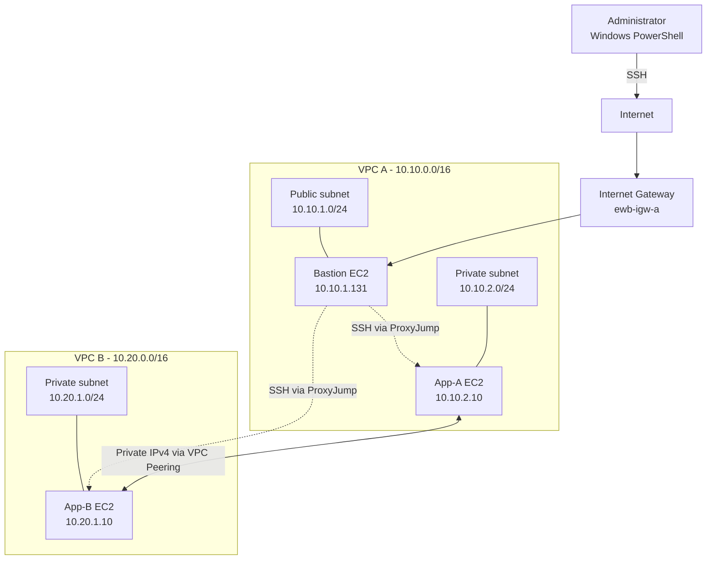

# AWS VPC Peering with Private EC2 Connectivity

## Project Overview

This project demonstrates secure private network communication between two
Amazon Virtual Private Clouds (VPCs) using AWS VPC Peering.

A bastion host provides SSH administration access to private EC2 instances.
The two application instances communicate using private IPv4 addresses.
Security groups restrict SSH and ICMP traffic to specified sources.

## Objectives

- Create two VPCs with non-overlapping IPv4 CIDR ranges.
- Configure public and private subnets.
- Configure an internet gateway for the bastion subnet.
- Establish and accept a VPC peering connection.
- Configure routes for communication between VPCs.
- Restrict access using security groups.
- Verify private connectivity in both directions.
- Demonstrate security-group enforcement with a controlled ICMP test.

## AWS Environment

| Resource | Configuration |
|---|---|
| AWS Region | Asia Pacific (Hyderabad), ap-south-2 |
| VPC A | 10.10.0.0/16 |
| VPC B | 10.20.0.0/16 |
| VPC A public subnet | 10.10.1.0/24 |
| VPC A private subnet | 10.10.2.0/24 |
| VPC B private subnet | 10.20.1.0/24 |
| Bastion private IP | 10.10.1.131 |
| App-A private IP | 10.10.2.10 |
| App-B private IP | 10.20.1.10 |

The application instances do not have public IPv4 addresses.

## Architecture



## Network and Security Design

- VPC A uses CIDR `10.10.0.0/16`.
- VPC B uses CIDR `10.20.0.0/16`.
- The VPC CIDR ranges do not overlap.
- The public route table routes internet-bound traffic through the
  internet gateway.
- The private route tables contain routes to the other VPC CIDR through
  the active peering connection.
- App-A and App-B have no public IPv4 addresses.
- SSH access to private instances is routed through the bastion host.
- Security-group inbound rules restrict SSH and ICMP traffic to the
  intended source addresses.

## SSH Access

Windows OpenSSH was configured to connect to the bastion and private
instances using the `ProxyJump` feature.

The private key remains on the administrator's computer and must not be
committed to this repository.

Example SSH aliases:

```powershell
ssh ewb-bastion
ssh ewb-app-a
ssh ewb-app-b
```

## Connectivity Tests

| Test | Result | Observation |
|---|---|---|
| App-A to App-B | PASS | 4 packets received, 0% loss |
| App-B to App-A | PASS | 4 packets received, 0% loss |
| Remove App-B inbound ICMP rule | EXPECTED FAILURE | 4 packets sent, 0 received |
| Restore App-B inbound ICMP rule | RECOVERED | 4 packets received, 0% loss |

The controlled failure demonstrates that the inbound ICMP security-group
rule affects whether App-A can ping App-B.

See the `evidence/` directory for screenshots of the tests.

## ## Evidence

Screenshots from the actual AWS environment and connectivity tests are included in the repository.

### AWS Configuration

| Evidence | File |
|---|---|
| VPC A | [`VPC-A.png`](evidence/Aws/VPC-A.png) |
| VPC B | [`VPC-B.png`](evidence/Aws/VPC-B.png) |
| Public subnet A | [`Public-Subnet-A.png`](evidence/Aws/Public-Subnet-A.png) |
| Private subnet A | [`Private-Subnet-A.png`](evidence/Aws/Private-Subnet-A.png) |
| Private subnet B | [`Private-Subnet-B.png`](evidence/Aws/Private-Subnet-B.png) |
| Internet Gateway | [`Internetgateway.png`](evidence/Aws/Internetgateway.png) |
| Public route table A | [`Routetable-Public-A.png`](evidence/Aws/Routetable-Public-A.png) |
| Private route table A | [`Routetable-Private-A.png`](evidence/Aws/Routetable-Private-A.png) |
| Private route table B | [`Routetable-Private-B.png`](evidence/Aws/Routetable-Private-B.png) |
| VPC peering connection | [`VPC-Peering-Connection.png`](evidence/Aws/VPC-Peering-Connection.png) |
| Bastion EC2 instance | [`EC2-Instance-Bastion.png`](evidence/Aws/EC2-Instance-Bastion.png) |
| App-A EC2 instance | [`EC2-Instance-app-A.png`](evidence/Aws/EC2-Instance-app-A.png) |
| App-B EC2 instance | [`EC2-Instance-app-B.png`](evidence/Aws/EC2-Instance-app-B.png) |
| Bastion security group | [`Security-Group-Bastion.png`](evidence/Aws/Security-Group-Bastion.png) |
| App-A security group | [`Security-Group-app-A.png`](evidence/Aws/Security-Group-app-A.png) |
| App-B security group | [`Security-Group-app-B.png`](evidence/Aws/Security-Group-app-B.png) |

### Connectivity Verification

| Test | Evidence |
|---|---|
| App-A → App-B | [`Successful ping`](evidence/Connectivity/01-app-a-to-app-b.png.png) |
| App-B → App-A | [`Successful ping`](evidence/Connectivity/02-app-b-to-app-a.png.png) |
| Controlled ICMP failure | [`Failure test`](evidence/Connectivity/03-controlled-failure.png.png) |
| Connectivity restored | [`Recovery test`](evidence/Connectivity/04-connectivity-restored.png.png) |

See [`docs/implementation-guide.md`](docs/implementation-guide.md) for the step-by-step implementation details.
## Lessons Learned

- VPC peering requires correct routes on both sides.
- Security groups must permit the intended traffic.
- Private EC2 instances can be administered through a bastion host
  without assigning them public IPv4 addresses.
- Testing in both directions helps verify bidirectional connectivity.
- Controlled failure and recovery tests help demonstrate the effect of
  security controls.

## Cleanup

After the evidence and report are complete, project resources should be
removed carefully to avoid ongoing charges. Verify that no project
instances, attached or leftover volumes, snapshots, or other billable
resources remain.

## Author and Project Details

- Author: Naresh Kalyan
- Project: EWB Cloud Labs Student Project
- Region: ap-south-2
- Date: October 2026

## Security Notes

Never commit private keys (`.pem`, `.ppk`), AWS credentials, access keys,
tokens, passwords, or other secrets. Review screenshots and documents
before publishing them.
